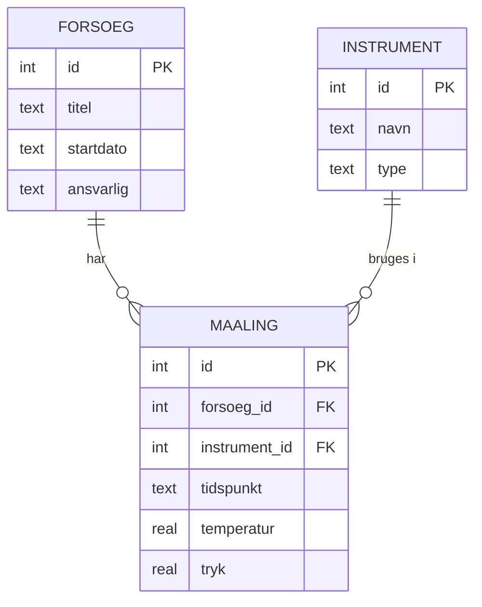

# Dag 3: Data – SQL og datamodellering

*Ca. 5 timer for kernen. **Kerne:** del A–F, undtagen øvelse 15. **Fordybelse:** øvelse 15 (gør API'et permanent), SQLBolt og SQL Murder Mystery.*

**Start dagen:** `git switch main && git pull && git switch -c opgaver/dag-3`. Se [ritualet på dag 1](../01-terminal-og-git/README.md#ritualet-hver-dag-fremover).

## Hvorfor?

Data er kernen i næsten alle de systemer, konsulenthuset bygger: sager, ansøgninger, borgere, betalinger, afgørelser. Koden kommer og går, men data bliver. Når et gammelt system bliver udskiftet, er det *data*, der skal flyttes med.

Som analytiker kommer du til at:
- **modellere** data: Hvilke ting findes der i domænet, og hvordan hænger de sammen?
- **skrive SQL** for at svare på spørgsmål, finde fejl og lave testdata
- **lave data mapping**: Hvilket felt i system A svarer til hvilket felt i system B?

Du har en kæmpe fordel: Du kan allerede pandas, og det meste af SQL er de samme tanker med andre ord.

## Videoer og interaktivt materiale

| Hvornår | Hvad | Længde |
|---------|------|--------|
| **Før du starter** | [SQL Explained in 100 Seconds](https://www.youtube.com/watch?v=zsjvFFKOm3c) (Fireship) | 2 min |
| **Til fordybelse** | [SQLBolt](https://sqlbolt.com/): interaktive SQL-øvelser i browseren, lektion 1–12. Godt at tage efter del B, eller senere, hvis du vil have mere træning | 1–2 timer |
| **Før del C** | [Entity Relationship Diagram (ERD) Tutorial – Part 1](https://www.youtube.com/watch?v=QpdhBUYk7Kk) (Lucid Software) | 7 min |
| **Efter del C** | [Learn Database Normalization – 1NF, 2NF, 3NF, 4NF, 5NF](https://www.youtube.com/watch?v=GFQaEYEc8_8) (Decomplexify). Det er en af de bedste forklaringer på normalisering. Se til og med 3NF | 15 min |
| **Belønning** | [The SQL Murder Mystery](https://mystery.knightlab.com/): løs et mord med SQL. Lavet til analytiske hjerner | 1 time |

---

## Del A: Hvorfor en database? (ca. 20 min)

På dag 2 forsvandt dine målinger, da serveren blev genstartet, fordi de kun lå i hukommelsen. Man kunne gemme dem i en CSV-fil, men det går galt, når:

- **to brugere skriver på samme tid** og overskriver hinanden
- **strømmen går midt i en skrivning**, så filen er halvt opdateret
- **nogen skriver noget ugyldigt**, f.eks. en temperatur, der er tekst, eller en måling til et forsøg, der ikke findes
- **data er for stort** til at ligge i hukommelsen, og man skal finde 10 rækker blandt 100 millioner hurtigt

En **database** løser de problemer. De fleste forretningssystemer bruger en **relationel database**: data ligger i **tabeller** med faste **kolonner** og **typer**, ligesom en DataFrame med strenge regler.

Programmet, der styrer databasen, hedder et **RDBMS** (*relational database management system*). Du vil møde:

| Produkt | Hvor |
|---------|------|
| **PostgreSQL** | Open source. Meget udbredt i nye systemer og i cloud |
| **Oracle** | Store, ældre systemer, ofte i det offentlige |
| **Microsoft SQL Server** | Udbredt i Microsoft-miljøer |
| **SQLite** | En database i én fil, uden server. Den bruger vi i dag, fordi den allerede er på din Mac |

Sproget hedder **SQL** (*Structured Query Language*, udtales "S-Q-L" eller "sequel"). Det er standardiseret, så det, du lærer i dag, virker næsten ens i alle produkterne. Der er små forskelle, som kaldes **dialekter**.

---

## Del B: SQL med pandas i baghovedet (ca. 90 min)

### Opret databasen

```bash
cd ~/kursus/SofiesITlearning/03-sql-og-datamodellering
sqlite3 lab.db < opret_lab.sql      # opret databasen fra scriptet
sqlite3 lab.db                      # åbn den
```

Nu er du i SQLite-prompten (`sqlite>`). Gør output pænt, og slå kontrol af fremmednøgler til. SQLite skal have det at vide hver gang:

```sql
.mode box
PRAGMA foreign_keys = ON;
.tables
.schema maaling
```

Kommandoer, der starter med `.`, er SQLite-specifikke. Alt andet er SQL. Hver SQL-sætning slutter med `;`. Du kommer ud med `.quit`.

Kig i [`opret_lab.sql`](opret_lab.sql). Der er tre tabeller: `forsoeg`, `instrument` og `maaling`. Hver måling peger på et forsøg og et instrument.

### SELECT: hent data

```sql
SELECT * FROM forsoeg;

SELECT tidspunkt, temperatur
FROM maaling
WHERE forsoeg_id = 2 AND temperatur > 25
ORDER BY temperatur DESC;
```

| SQL | pandas |
|-----|--------|
| `SELECT tidspunkt, temperatur` | `df[["tidspunkt", "temperatur"]]` |
| `FROM maaling` | `df = maaling` |
| `WHERE temperatur > 25` | `df[df.temperatur > 25]` eller `df.query("temperatur > 25")` |
| `ORDER BY temperatur DESC` | `df.sort_values("temperatur", ascending=False)` |
| `LIMIT 5` | `df.head(5)` |

SQL er **deklarativt**: Du beskriver *hvad* du vil have, ikke *hvordan* det skal findes. Databasen finder selv den hurtigste vej.

### Aggregering og GROUP BY

```sql
SELECT COUNT(*) AS antal, AVG(temperatur) AS gns, MAX(tryk) AS max_tryk
FROM maaling;

SELECT forsoeg_id, COUNT(*) AS antal, ROUND(AVG(temperatur), 1) AS gns_temp
FROM maaling
GROUP BY forsoeg_id;
```

Den sidste svarer til `df.groupby("forsoeg_id").agg(...)`. Vil du filtrere *efter* grupperingen, bruger du `HAVING`:

```sql
SELECT forsoeg_id, COUNT(*) AS antal
FROM maaling
GROUP BY forsoeg_id
HAVING COUNT(*) > 5;
```

`WHERE` filtrerer rækker *før* gruppering, og `HAVING` filtrerer grupper *efter*.

### JOIN: kombinér tabeller

Tabellen `maaling` indeholder kun `forsoeg_id = 2`, ikke forsøgets navn. Navnet ligger i `forsoeg`. Med en **JOIN** kobler du dem sammen:

```sql
SELECT f.titel, m.tidspunkt, m.temperatur
FROM maaling m
JOIN forsoeg f ON f.id = m.forsoeg_id
WHERE f.titel = 'Temperaturserie';
```

Det svarer til `maaling.merge(forsoeg, left_on="forsoeg_id", right_on="id")`. `m` og `f` er korte **aliaser** for tabelnavnene.

| SQL | pandas `merge(how=...)` | Betydning |
|-----|--------------------------|-----------|
| `JOIN` (= `INNER JOIN`) | `"inner"` | Kun rækker, der matcher i begge tabeller |
| `LEFT JOIN` | `"left"` | Alle rækker fra venstre tabel, også dem uden match |

Forskellen er vigtig. Sammenlign:

```sql
-- Antal målinger pr. forsøg. Hvor blev Pilotforsøg af?
SELECT f.titel, COUNT(*) AS antal
FROM forsoeg f JOIN maaling m ON m.forsoeg_id = f.id
GROUP BY f.id;

-- Med LEFT JOIN kommer Pilotforsøg med, med 0 målinger
SELECT f.titel, COUNT(m.id) AS antal
FROM forsoeg f LEFT JOIN maaling m ON m.forsoeg_id = f.id
GROUP BY f.id;
```

### NULL: den manglende værdi

`NULL` betyder "ukendt" eller "ikke angivet", ligesom `NaN` i pandas. Det er **ikke** 0 og ikke en tom tekst. Det driller:

```sql
SELECT COUNT(*) FROM maaling WHERE temperatur = NULL;    -- 0 (!)
SELECT COUNT(*) FROM maaling WHERE temperatur IS NULL;   -- 5
```

Intet er lig med NULL, heller ikke NULL selv. Brug `IS NULL` og `IS NOT NULL`. `AVG`, `SUM` og lignende springer NULL over, præcis som pandas.

### Ændre data: INSERT, UPDATE og DELETE

```sql
INSERT INTO maaling (forsoeg_id, instrument_id, tidspunkt, temperatur, tryk)
VALUES (4, 3, '2026-10-01 10:00', 21.5, 1012.0);

UPDATE forsoeg SET ansvarlig = 'Sofie' WHERE id = 4;

DELETE FROM maaling WHERE id = 19;
```

> **Glem aldrig `WHERE`** i `UPDATE` og `DELETE`. `DELETE FROM maaling;` sletter *alle* målinger. Det er en af de klassiske fejl. Kør altid den tilsvarende `SELECT` med samme `WHERE` først, så du kan se, hvad du rammer.

### Constraints: databasen passer på data

Prøv at indsætte en måling til et forsøg, der ikke findes:

```sql
INSERT INTO maaling (forsoeg_id, instrument_id, tidspunkt) VALUES (99, 1, '2026-10-01 10:00');
```

`FOREIGN KEY constraint failed`. Det er databasen, der håndhæver **referentiel integritet**: En måling kan ikke pege på et forsøg, der ikke findes. Andre **constraints** i scriptet er `NOT NULL` (feltet skal udfyldes) og `UNIQUE` (ingen dubletter).

### Transaktioner

En **transaktion** er en gruppe ændringer, der enten *alle* bliver gennemført eller *ingen* af dem. Klassisk eksempel: en bankoverførsel, hvor der trækkes fra én konto og sættes ind på en anden. Det må aldrig kun ske halvt.

```sql
BEGIN;
DELETE FROM maaling;
SELECT COUNT(*) FROM maaling;    -- 0. Hov!
ROLLBACK;                        -- fortryd det hele
SELECT COUNT(*) FROM maaling;    -- 18 igen
```

`COMMIT` i stedet for `ROLLBACK` havde gjort det permanent. Egenskaberne kaldes **ACID**: *Atomicity* (alt eller intet), *Consistency* (regler overholdes), *Isolation* (samtidige transaktioner forstyrrer ikke hinanden) og *Durability* (det, der er committet, overlever et nedbrud).

### Øvelser B

Skriv dine forespørgsler i en fil `noter/dag-3.sql`, så du kan aflevere dem. `noter/` ligger i roden af repoet, så fra denne mappe kører du filen med `sqlite3 lab.db < ../noter/dag-3.sql`. Du kan også kopiere enkelte sætninger ind i prompten.

1. Hvilke målinger har både temperatur og tryk? Sortér efter tidspunkt.
2. Hvad er den laveste og højeste temperatur i *Temperaturserie*? Brug forsøgets titel, ikke dets id.
3. Hvor mange målinger har hvert instrument lavet? Medtag instrumenter med 0 målinger.
4. Hvilket instrument er aldrig blevet brugt? *Hint:* `LEFT JOIN` og `IS NULL`.
5. Vis for hvert forsøg titel, ansvarlig, antal målinger og gennemsnitlig temperatur, afrundet til én decimal.
6. Hvilke forsøg har mere end 5 målinger?
7. Trykket falder i *Trykfald*. Hvor meget falder det pr. time ifølge barometeret `B-20`? Du kan regne det sidste i hånden, men find først de rigtige tal med SQL.

---

## Del C: Datamodellering (ca. 60 min)

At modellere data er at beslutte, *hvilke tabeller der skal være, og hvordan de hænger sammen*, før der bliver skrevet kode. Det er kerneopgave for en analytiker, og fejl her er dyre at rette senere.

### Begreberne

- **Entitet**: en "ting" i domænet, f.eks. Forsøg, Instrument, Borger eller Ansøgning. Den bliver til en tabel.
- **Attribut**: en egenskab ved entiteten, f.eks. titel eller startdato. Den bliver til en kolonne.
- **Primærnøgle** (*primary key*, PK): en kolonne, der entydigt identificerer en række. Typisk et `id`.
- **Fremmednøgle** (*foreign key*, FK): en kolonne, der peger på en primærnøgle i en anden tabel, f.eks. `maaling.forsoeg_id → forsoeg.id`.
- **Relation**: hvordan entiteter hænger sammen, og med hvilken **kardinalitet**:

| Kardinalitet | Eksempel | Sådan bliver det til tabeller |
|--------------|----------|-------------------------------|
| **1:N** (én til mange) | Ét forsøg har mange målinger | FK på "mange"-siden: `maaling.forsoeg_id` |
| **N:M** (mange til mange) | En borger kan eje flere boliger, og en bolig kan have flere ejere | En ekstra **koblingstabel** (*junction table*): `ejerskab(borger_id, bolig_id)` |
| **1:1** | En ansøgning har højst én afgørelse | FK med `UNIQUE`, eller samme tabel |

### ER-diagrammer

Et **ER-diagram** (*entity-relationship*) tegner modellen. Det er det, der hænger på væggen i projektrummet. Her er lab-databasen tegnet i **Mermaid**, et tekstformat til diagrammer, som GitHub viser som en tegning:



Stregerne i enderne er **crow's foot**-notation:

| Symbol | Betydning |
|--------|-----------|
| `\|\|` | præcis én |
| `o\|` | nul eller én |
| `o{` | nul eller mange |
| `\|{` | én eller mange |

`FORSOEG ||--o{ MAALING` læses altså: "Et forsøg har nul eller mange målinger. En måling hører til præcis ét forsøg."

> Se diagrammet på GitHub, eller installér extensionen til VS Code-preview:
> `code --install-extension bierner.markdown-mermaid`

Man taler ofte om tre niveauer: den **konceptuelle model** (hvilke ting findes, tegnet sammen med kunden), den **logiske model** (attributter, nøgler og relationer) og den **fysiske model** (præcise tabeller og typer i et bestemt RDBMS).

### Normalisering: hvorfor ikke bare ét stort regneark?

Kig i [`forsoeg_regneark.csv`](forsoeg_regneark.csv). Det er de samme data, som de ofte ser ud i virkeligheden: én stor tabel, hvor alt står på hver linje.

Du skal bruge pandas. Den er ikke installeret i Homebrews Python, så lav et venv i mappen, som på dag 2 (det skal også bruges i del E):

```bash
cd ~/kursus/SofiesITlearning/03-sql-og-datamodellering
python3 -m venv .venv
source .venv/bin/activate
pip install pandas
python3
```

Indlæs filen i pandas og kig:

```python
import pandas as pd
df = pd.read_csv("forsoeg_regneark.csv")
df[["ansvarlig", "ansvarlig_email"]].drop_duplicates()
df[["instrument", "instrument_type"]].drop_duplicates()
```

Der er fejl i data, og det er ikke et tilfælde. Når den samme oplysning står mange steder, opstår der **anomalier**:

- **Opdateringsanomali**: Mads får ny e-mail, men den bliver kun rettet på nogle af linjerne. Hvad er så hans rigtige adresse?
- **Indsættelsesanomali**: Du kan ikke registrere et nyt instrument, før det har lavet en måling.
- **Sletningsanomali**: Sletter du den sidste måling fra et forsøg, forsvinder forsøget, dets startdato og den ansvarlige også.

**Normalisering** er metoden til at undgå det: Hver oplysning skal stå ét sted, og alt andet skal pege derhen. De første tre normalformer, kort fortalt:

1. **1NF**: Hver celle indeholder én værdi, ikke en liste som `"T-100, B-20"`.
2. **2NF**: Hver kolonne afhænger af *hele* nøglen, ikke kun en del af den.
3. **3NF**: Ingen kolonne afhænger af en anden kolonne, der ikke er nøglen. `ansvarlig_email` afhænger af `ansvarlig`, ikke af målingen, så den hører hjemme i en `person`-tabel.

Huskeregel: *"Every non-key attribute must depend on the key, the whole key, and nothing but the key."*

Lab-databasen er næsten normaliseret. Men `forsoeg.ansvarlig` er tekst, og det er derfor, `Sofie` og `sofie` i regnearket bliver til to personer.

Normalisering er ikke en religion. Til rapporter og analyse **denormaliserer** man nogle gange med vilje, så data er hurtige at læse. Men et system, der *registrerer* data, skal være normaliseret.

### Øvelser C

8. Find alle anomalierne i `forsoeg_regneark.csv`. Der er mindst tre forskellige fejl. Hvilken type anomali er de udtryk for?
9. Tegn en normaliseret model for regnearket i Mermaid, med en `person`-tabel. Skriv den i `noter/dag-3.md`, og se den på GitHub, når du har pushet.

---

## Del D: Case – tilskud til energirenovering (ca. 90 min)

Nu skal du modellere noget, der ligner det, du kommer til at arbejde med. En kommune vil have et system til ansøgninger om tilskud til energirenovering. Fra workshoppen med kunden har du disse noter:

> - Borgere søger om tilskud. Vi skal kende deres CPR-nummer, navn og e-mail.
> - En ansøgning gælder én bolig. Vi kender boligens adresse og opførelsesår.
> - En bolig kan have flere ejere, og en borger kan eje flere boliger. Kun ejere må søge.
> - En ansøgning har et ansøgt beløb, en indsendelsesdato og en status: *modtaget*, *under behandling*, *bevilget* eller *afslået*.
> - Hver ansøgning bliver tildelt én sagsbehandler (en medarbejder i kommunen med navn og afdeling).
> - Borgeren kan vedhæfte dokumenter (tilbud, fotos, energimærke) til ansøgningen.
> - Når sagen er afgjort, registreres en afgørelse med dato, bevilget beløb og begrundelse.

### Øvelser D

10. **ER-diagram.** Find entiteterne, attributterne og relationerne, og tegn modellen i Mermaid i `noter/dag-3.md`. Pas på N:M-relationen.
11. **Tabeller.** Skriv `CREATE TABLE`-sætningerne i `noter/tilskud.sql`, med primærnøgler, fremmednøgler og `NOT NULL`, hvor det giver mening. Hvordan sikrer du, at status kun kan have de fire tilladte værdier? Der er to gode løsninger: en `CHECK`-constraint eller en opslagstabel. Hvad er fordele og ulemper?
12. **Testdata.** Indsæt nok data til at kunne svare på spørgsmålene herunder: 3–4 borgere, et par boliger, 6–8 ansøgninger med forskellige statusser og et par sagsbehandlere. **Brug opdigtede CPR-numre.**
13. **Forespørgsler.** Besvar med SQL:
    - Hvor mange ansøgninger er der i hver status?
    - Hvilken sagsbehandler har flest ansøgninger *under behandling*?
    - Hvilke ansøgninger har ingen dokumenter?
    - Hvad er det samlede bevilgede beløb?
    - Hvilke borgere har søgt til en bolig, de ikke ejer? (Hvis din model kan forhindre det, er det endnu bedre. Kan den?)
14. **Refleksion.** Hvilke kolonner er **persondata**? Hvad betyder det for, hvem der må se dem, og for testdata i et testmiljø? Skriv et par linjer.

Der er ikke én rigtig løsning. Når du har en model, så bed Claude om at reviewe den: *"Review min datamodel. Stil mig spørgsmål om de valg, jeg har truffet, i stedet for at give mig en ny model."*

---

## Del E: Python og SQL, og API'et fra dag 2 (ca. 45 min)

### Fra Python

```python
import sqlite3
import pandas as pd

conn = sqlite3.connect("lab.db")
df = pd.read_sql("SELECT * FROM maaling", conn)     # SQL -> DataFrame
df.groupby("forsoeg_id")["temperatur"].mean()

pd.read_csv("forsoeg_regneark.csv").to_sql("regneark", conn, if_exists="replace", index=False)
```

Brug det venv, du lavede i del C (`source .venv/bin/activate`).

### SQL injection: den vigtigste sikkerhedsregel

Byg **aldrig** SQL ved at sætte tekst sammen med data fra en bruger:

```python
titel = input("Titel: ")    # brugeren skriver:  x' OR '1'='1
conn.execute(f"SELECT * FROM forsoeg WHERE titel = '{titel}'").fetchall()
# -> ALLE forsøg. SQL'en blev til: ... WHERE titel = 'x' OR '1'='1'
```

Brug i stedet **parametre** (`?`). Så bliver input altid behandlet som data og aldrig som SQL:

```python
conn.execute("SELECT * FROM forsoeg WHERE titel = ?", (titel,)).fetchall()
# -> []
```

Det hedder **SQL injection** og har været en af de mest udnyttede sikkerhedsfejl nogensinde. Se den klassiske [xkcd: Exploits of a Mom](https://xkcd.com/327/).

### Øvelse E

15. **Gør API'et fra dag 2 permanent** (fordybelse). Kopiér din `server.py` fra dag 2 hertil, og få den til at gemme målinger i en SQLite-database `maalinger.db` i stedet for i et dict. Genstart serveren, og se, at data overlever.

    *Hints:*
    - Opret forbindelse og tabel øverst: `conn = sqlite3.connect("maalinger.db")` og `CREATE TABLE IF NOT EXISTS ...`
    - `conn.row_factory = sqlite3.Row` får rækkerne til at opføre sig som dicts: `dict(row)`
    - Ved `INSERT` får du det nye id med `cursor.lastrowid`
    - Husk `conn.commit()` efter ændringer
    - Brug `?`-parametre, altid
    - `.db`-filen skal ikke i Git. Tjek, at `*.db` står i `.gitignore` i roden af repoet

---

## Del F: Ord du vil høre (ca. 15 min)

Du skal ikke kunne det her endnu, men du skal vide, hvad det betyder:

- **Index**: en "indholdsfortegnelse" på en kolonne, så søgninger går hurtigt. "Forespørgslen er langsom, mangler der et index?"
- **View**: en gemt forespørgsel, der kan bruges som en tabel.
- **Migration**: et versioneret script, der ændrer databasens struktur (tilføjer en kolonne, laver en ny tabel). Migrations ligger i Git og køres automatisk. Værktøjer: *Flyway*, *Liquibase*.
- **ORM** (*object-relational mapping*): et bibliotek, der oversætter mellem kodens objekter og databasens tabeller, så udviklerne ikke skriver al SQL i hånden. Java: *Hibernate/JPA*. C#: *Entity Framework*.
- **OLTP og OLAP / data warehouse**: Driftsdatabasen (OLTP) registrerer data, mange små transaktioner. Et **data warehouse** (OLAP) samler data til rapporter og analyse og er ofte denormaliseret.
- **ETL** (*extract, transform, load*): at hente data fra ét system, omforme dem og læse dem ind i et andet.
- **Datamigrering**: at flytte data fra et gammelt system til et nyt. Det er en stor del af mange offentlige projekter, og den er tung på analyse: Hvad betyder feltet `STATUS_KD = 7` i det gamle system?
- **Data mapping**: et dokument, der beskriver, hvilket felt i kilden der svarer til hvilket felt i målet, og hvordan værdierne skal oversættes.
- **Stamdata / master data**: de grundlæggende data, som alt andet peger på, f.eks. personer, adresser og produkter.
- **Anonymisering og pseudonymisering**: at fjerne eller erstatte persondata, så de kan bruges i test. Rigtige CPR-numre hører ikke hjemme i et testmiljø.

---

## Aflevering

Commit og push din branch `opgaver/dag-3`, og aflevér via PR:
- `noter/dag-3.sql`: dine forespørgsler fra øvelse 1–7
- `noter/dag-3.md`: anomalier (8), Mermaid-diagrammer (9 og 10), status-overvejelser (11) og refleksion (14)
- `noter/tilskud.sql`: tabeller, testdata og forespørgsler (11–13)
- hvis du har lavet fordybelsen: `server.py` med SQLite (15)

## Spørg Claude

- *"Forklar forskellen på INNER JOIN og LEFT JOIN med et eksempel fra pandas."*
- *"Jeg har skrevet den her forespørgsel, men får for mange rækker. Hvorfor? Giv mig et hint."*
- *"Forklar 2NF med et eksempel, hvor nøglen består af to kolonner."*
- *"Review min ER-model for tilskudssagen. Stil spørgsmål i stedet for at rette den."*
- *"Hvad er forskellen på at anonymisere og pseudonymisere, og hvad siger GDPR?"*
- *"Giv mig 5 SQL-opgaver på lab-databasen, der bliver gradvist sværere."*

## Tjekliste: kan du...

- [ ] forklare, hvorfor man bruger en database frem for en CSV-fil?
- [ ] skrive `SELECT` med `WHERE`, `ORDER BY`, `GROUP BY` og `HAVING`?
- [ ] forklare og bruge `JOIN` og `LEFT JOIN`?
- [ ] forklare, hvorfor `= NULL` ikke virker?
- [ ] forklare primærnøgle, fremmednøgle og en koblingstabel?
- [ ] tegne et ER-diagram med kardinaliteter?
- [ ] forklare de tre anomalier, og hvad normalisering løser?
- [ ] forklare, hvad SQL injection er, og hvordan man undgår det?
- [ ] forklare, hvad en transaktion er?

## Ordliste

| Ord | Betydning |
|-----|-----------|
| **database / RDBMS** | Et system, der gemmer data sikkert / programmet, der styrer en relationel database |
| **tabel / række / kolonne** | Svarer til DataFrame / række / kolonne |
| **SQL** | Sproget til relationelle databaser |
| **query / forespørgsel** | En SQL-sætning, der henter data |
| **schema** | Databasens struktur: tabeller, kolonner, typer og constraints |
| **PostgreSQL / Oracle / SQL Server / SQLite** | Udbredte databaseprodukter |
| **primærnøgle (PK)** | Entydig identifikation af en række |
| **fremmednøgle (FK)** | En kolonne, der peger på en række i en anden tabel |
| **constraint** | En regel, databasen håndhæver (`NOT NULL`, `UNIQUE`, `CHECK`, FK) |
| **referentiel integritet** | Fremmednøgler peger altid på noget, der findes |
| **JOIN / LEFT JOIN** | Kombinér tabeller / medtag også rækker uden match |
| **aggregering** | `COUNT`, `SUM`, `AVG`, `MIN`, `MAX`, ofte med `GROUP BY` |
| **NULL** | Manglende værdi. Test med `IS NULL` |
| **transaktion / commit / rollback** | Alt-eller-intet-ændring / gør permanent / fortryd |
| **ACID** | De fire garantier for transaktioner |
| **entitet / attribut** | En ting i domænet / en egenskab ved den |
| **kardinalitet** | 1:1, 1:N eller N:M |
| **koblingstabel** | Tabellen, der løser en N:M-relation |
| **ER-diagram / ERD** | Tegning af datamodellen |
| **crow's foot** | Notationen for kardinalitet i ER-diagrammer |
| **konceptuel / logisk / fysisk model** | De tre detaljeniveauer for en datamodel |
| **normalisering / 1NF–3NF** | Hver oplysning ét sted |
| **denormalisering** | Bevidst gentagelse af data for at gøre læsning hurtig |
| **anomali** | En fejl, der opstår, fordi data står flere steder |
| **SQL injection** | Et angreb, hvor input bliver fortolket som SQL. Undgås med parametre |
| **index / view** | Hurtig opslag / gemt forespørgsel |
| **migration** | Et versioneret script, der ændrer databasestrukturen (Flyway, Liquibase) |
| **ORM** | Oversætter mellem objekter i koden og tabeller (Hibernate, Entity Framework) |
| **OLTP / OLAP / data warehouse** | Driftsdatabase / analysedatabase |
| **ETL** | Extract, transform, load |
| **datamigrering / data mapping** | Flyt data fra gammelt til nyt system / beskriv, hvordan felterne svarer til hinanden |
| **stamdata / master data** | Grunddata, som alt andet peger på |
| **anonymisering / pseudonymisering** | Fjern / erstat persondata |
| **Mermaid** | Tekstformat til diagrammer, som GitHub viser |
